<div align="center">

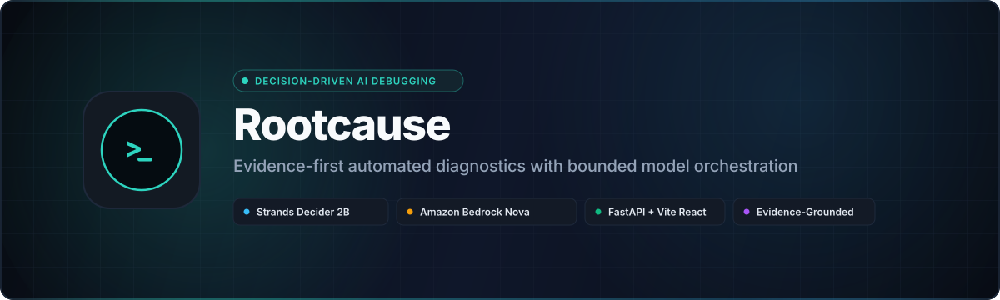

<br/><br/>

[](LICENSE)
[](requirements.txt)
[](tests/)
[](src/api.py)
[](frontend/)
[](src/decider_client.py)
[](src/analysis.py)

**Rootcause** is an evidence-first, decision-driven autonomous AI debugging engine for Python applications.<br/>
It replaces unconstrained generative LLM chat loops with **deterministic, bounded action selection** via **Strands Decider 2B**<br/>
and **schema-enforced causal synthesis** via **Amazon Bedrock Nova Micro**.

[Explore Architecture](#system-architecture) • [Demo Walkthrough](#reproducible-scenario-walkthrough) • [Quickstart Guide](#quickstart--installation) • [Security Model](docs/SECURITY.md) • [Engineering Log](docs/ENGINEERING-LOG.md)

</div>

---

## Table of Contents

- [Problem Statement](#problem-statement)
- [Decider-Driven Debugging: Why Decision-First?](#decider-driven-debugging-why-decision-first)
- [Actual Product Interface](#actual-product-interface)
- [System Architecture](#system-architecture)
  - [System Context Diagram](#system-context-diagram)
  - [Decision-Evidence Loop](#decision-evidence-loop)
  - [Request Execution & Failure Recovery Sequence](#request-execution--failure-recovery-sequence)
  - [Component Architecture & Call Graph](#component-architecture--call-graph)
- [Model Division of Labor](#model-division-of-labor)
- [Core Capabilities](#core-capabilities)
- [Reproducible Scenario Walkthrough](#reproducible-scenario-walkthrough)
- [Curated Demo Scenario Catalogue](#curated-demo-scenario-catalogue)
- [Technology Stack](#technology-stack)
- [Repository Layout](#repository-layout)
- [Quickstart & Installation](#quickstart--installation)
  - [Prerequisites](#prerequisites)
  - [Step 1: Clone & Configure Virtual Environment](#step-1-clone--configure-virtual-environment)
  - [Step 2: Start Local Strands Decider 2B Service](#step-2-start-local-strands-decider-2b-service)
  - [Step 3: Configure AWS Bedrock Credentials](#step-3-configure-aws-bedrock-credentials)
  - [Step 4: Launch Backend & Frontend](#step-4-launch-backend--frontend)
- [Verification & Testing Guide](#verification--testing-guide)
- [Security Model & Trust Boundaries](#security-model--trust-boundaries)
- [Troubleshooting & FAQs](#troubleshooting--faqs)
- [Engineering Log & Architectural Decisions](#engineering-log--architectural-decisions)
- [Contributing & License](#contributing--license)

---

## Problem Statement

When an application crashes in production or fails in CI/CD, developers face a high-friction triage loop:
1. **Ambiguous Stack Traces**: An exception trace (e.g. `ModuleNotFoundError`, `ConnectionRefusedError`, or `KeyError`) describes *where* execution halted, but rarely identifies the systemic *root cause* (such as missing virtualenv declarations, port collision, or version conflicts).
2. **Hallucination-Prone AI Assistants**: General-purpose chat LLMs frequently guess solutions based on language patterns rather than ground-truth runtime observations, recommending unnecessary refactors or phantom packages.
3. **Runaway Agent Loops**: Autonomous agent frameworks without strict action constraints often execute redundant shell commands, enter circular inspection loops, or overwrite user files.

**Rootcause** solves this by enforcing an **evidence-grounded, bounded diagnostic loop**:
- It never guesses a root cause without executing targeted, read-only diagnostic probes.
- Action selection is strictly governed by a local 2B decision model operating over a finite action registry.
- Every investigation is bounded by a hard step budget (default 3, max 10) with explicit truncation notices.
- Final natural language synthesis is strictly conditioned on confirmed observations, explicitly segregating verified facts from unverified hypotheses.

---

## Decider-Driven Debugging: Why Decision-First?

Traditional AI agents rely on a monolithic LLM to perform planning, tool selection, argument generation, and code generation simultaneously. This creates massive failure modes:

```
Traditional Monolithic Agent:
[Error] ──> [70B Cloud LLM] ──> [Arbitrary Shell Cmds] ──> [Infinite Loop / Hallucinated Fix]

Rootcause Decision-First Architecture:
[Error] ──> [Action Registry] ──> [Strands Decider 2B] ──> [Read-Only Diagnostics] ──> [Bedrock Synthesis]
                 │                        │                         │
                 ▼                        ▼                         ▼
          Strict Whitelist        Deterministic Choice       Audited Evidence History
```

### Key Principles of Decision-First Orchestration

1. **Discrete State Spaces**: Rather than generating unstructured bash strings, the model is offered an explicit set of safe diagnostic actions (`inspect_dependencies`, `inspect_source`, `run_tests`, `check_dependency`, `stop_and_report`).
2. **Deduplication by Construction**: Actions executed in previous steps are automatically pruned from the registry for subsequent cycles. A diagnostic tool can run at most once per investigation.
3. **Fail-Closed Validation**: If the Decider returns a tool not present in the offered criteria, execution halts immediately with `DeciderValidationError` rather than guessing intent.
4. **Zero-Fabrication Synthesis**: Amazon Bedrock Nova Micro is provided the verified diagnostic trace and enforced via system prompt rules: if evidence is insufficient, it must return `evidence_sufficient: false` rather than inventing certainty.

---

## Actual Product Interface

Rootcause features a modern, real-time diagnostic workstation built with React, Vite, and vanilla CSS. The screenshots below demonstrate actual runtime operation against local test fixtures.

### 1. Diagnostic Workspace (Clean State)
The primary workspace provides environment telemetry (FastAPI engine status, local Decider 2B connection, Bedrock availability), target repository selection, and stack trace ingestion.

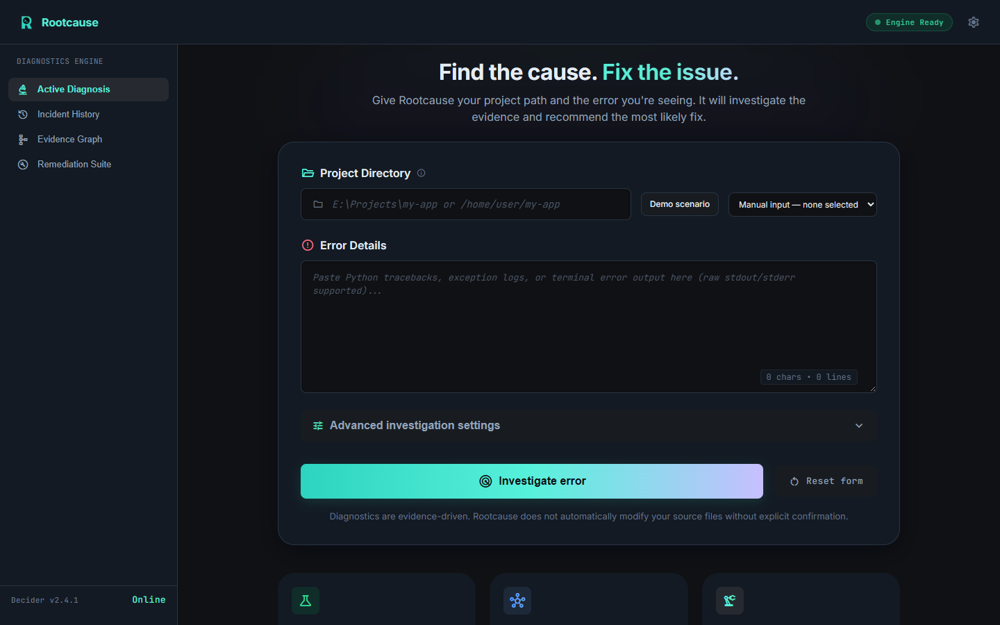
*Figure 1: Clean Rootcause diagnostic workspace with live service health indicators and parameter controls.*

---

### 2. Demo Scenario Selection
The UI includes a scenario selector pre-populated with 10 reproducible failure fixtures. Selecting a scenario loads the fixture path and exact error trace without auto-executing.

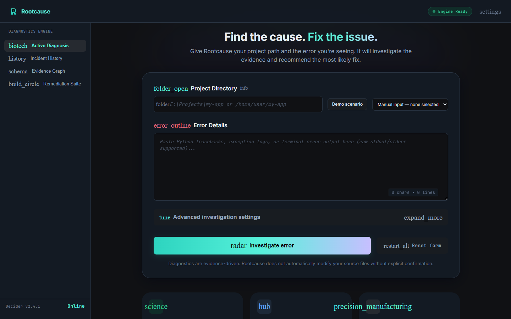
*Figure 2: Loading the "Missing Python Dependency" scenario with auto-populated parameters and diagnostic boundaries.*

---

### 3. Real-Time Investigation Execution Trace
When an investigation is initiated, the UI provides live status telemetry while the local Decider 2B and diagnostic probes evaluate the workspace.

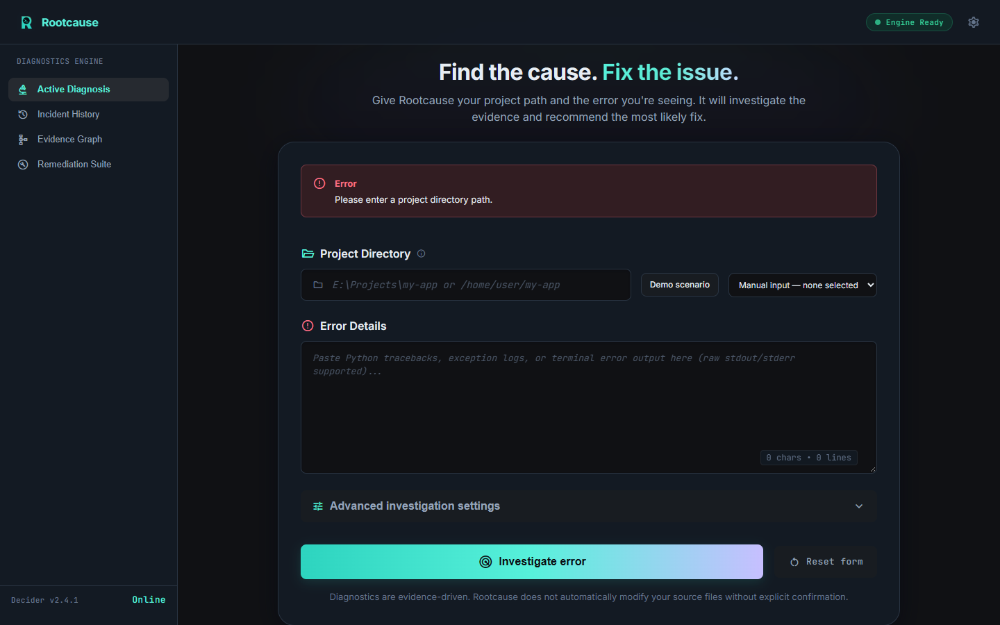
*Figure 3: Live diagnostic execution trace showing step progression, elapsed time, and targeted probe dispatch.*

---

### 4. Evidence-Grounded Root Cause Report
Upon investigation completion, Rootcause presents the primary cause, evidence sufficiency, confirmed observations, alternative hypotheses, remaining uncertainties, and actionable remediation steps.

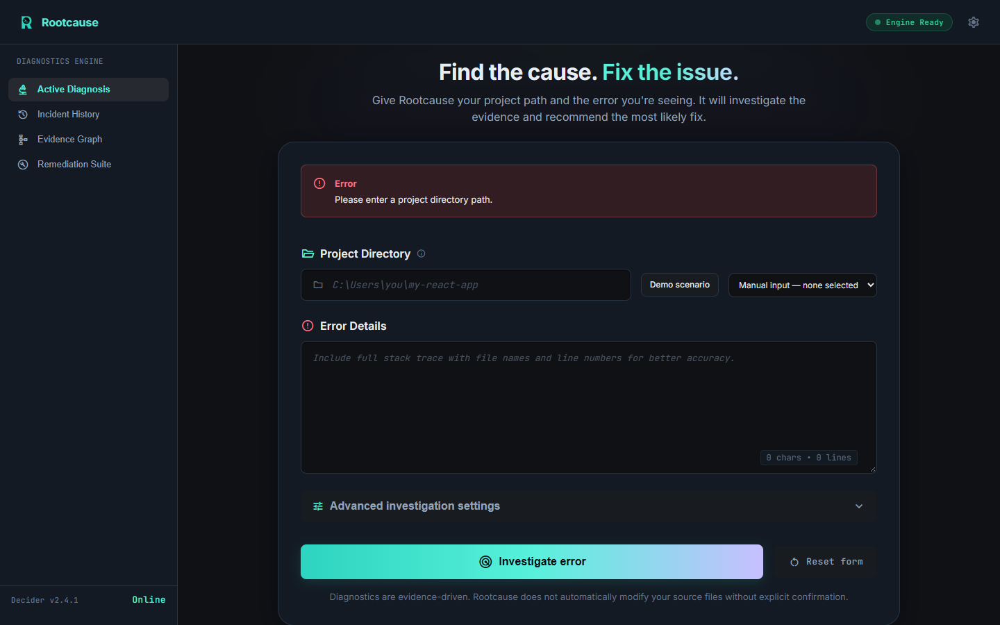
*Figure 4: Synthesized Root Cause Report showing confirmed observations, evidence references, and actionable fix.*

---

### 5. Interactive Evidence Graph & Incident History
Rootcause captures an auditable trace of every diagnostic probe and persists investigation runs for longitudinal incident analysis.

| Evidence Graph View | Incident History Audit Log |
|:---:|:---:|
| 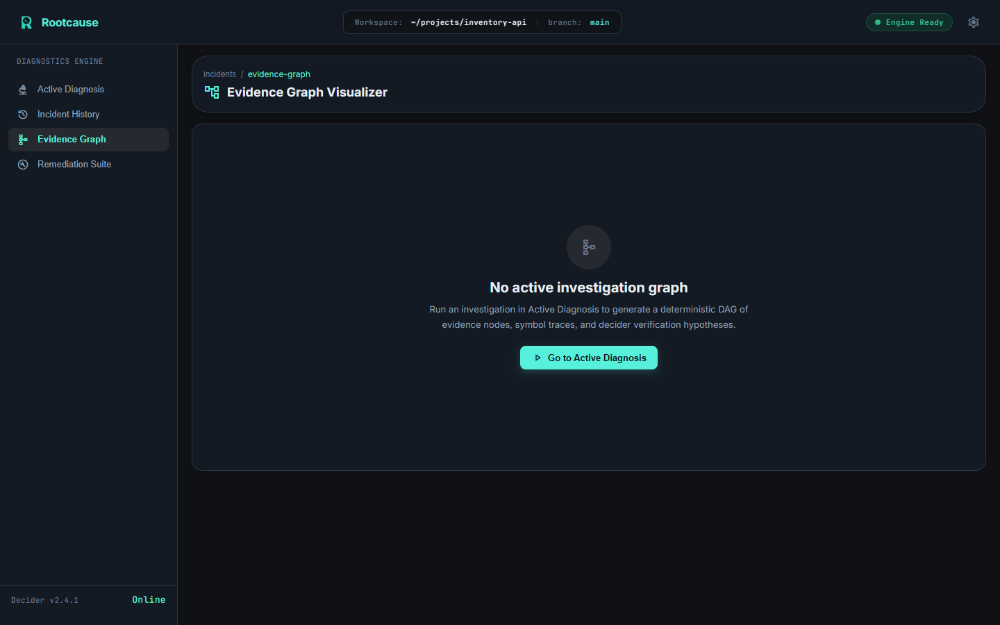 | 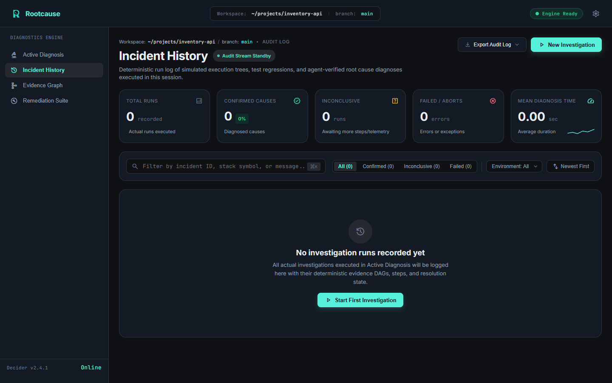 |
| *Figure 5: Topological relationship between errors, manifests, and probe observations.* | *Figure 6: Persistent incident audit log with status badges, elapsed durations, and timestamps.* |

---

## System Architecture

### System Context Diagram

The diagram below maps the runtime boundaries between the developer workstation, local services, target repository filesystem, and AWS Cloud reasoning.

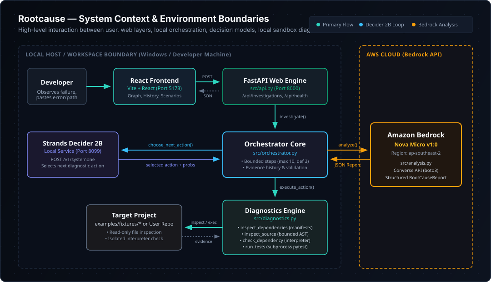
*Editable source file: [docs/architecture/system-context.drawio](docs/architecture/system-context.drawio)*

---

### Decision-Evidence Loop

The internal orchestration cycle executes a bounded state machine where each diagnostic output directly enriches the evidence history for subsequent Decider evaluations.

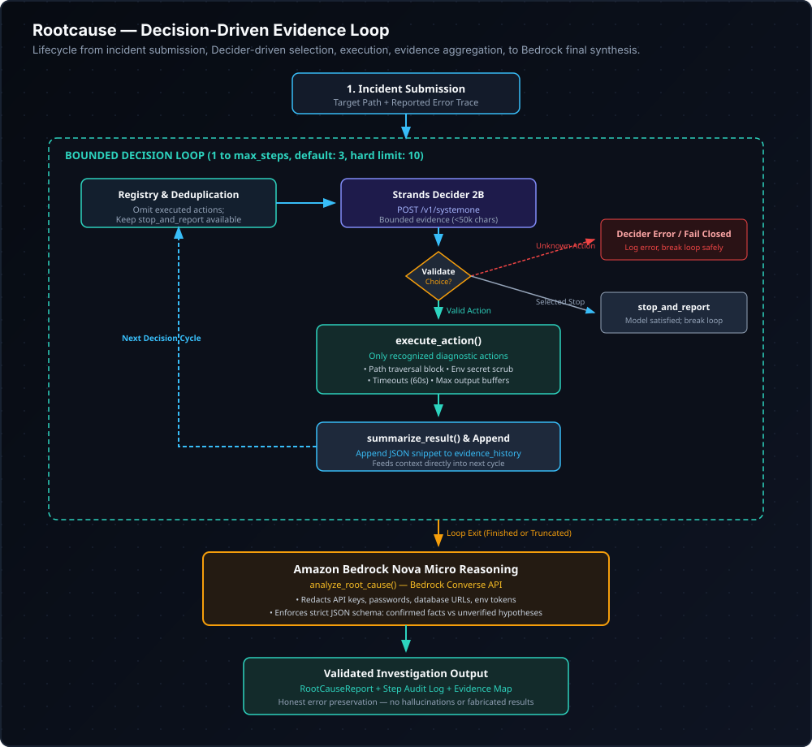
*Editable source file: [docs/architecture/decision-flow.drawio](docs/architecture/decision-flow.drawio)*

---

### Request Execution & Failure Recovery Sequence

Rootcause is designed for resilience: if external services (Decider 2B or Bedrock) fail or time out, the system degrades gracefully, records the diagnostic history honestly, and avoids fabricating findings.

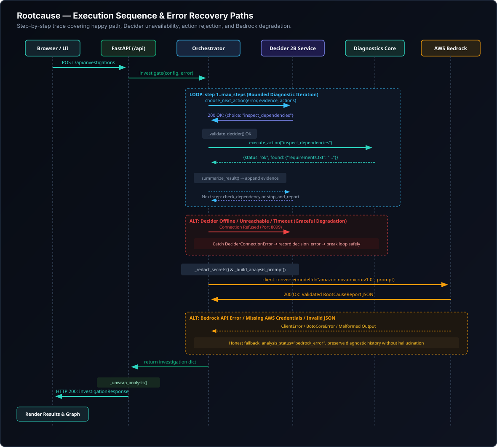
*Editable source file: [docs/architecture/sequence-diagram.drawio](docs/architecture/sequence-diagram.drawio)*

---

### Component Architecture & Call Graph

The diagram below reflects the verified module responsibilities and imports across the Python codebase.

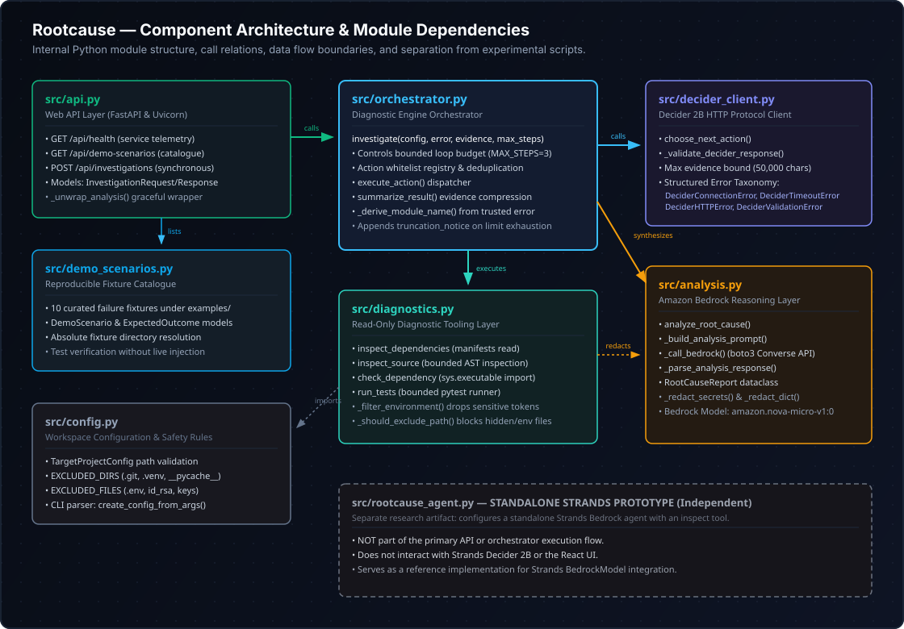
*Editable source file: [docs/architecture/component-architecture.drawio](docs/architecture/component-architecture.drawio)*

---

## Model Division of Labor

Rootcause pairs a specialized local model with a cloud inference model to optimize for latency, security, and reasoning depth:

```
┌────────────────────────────────────────────────────────────────────────────────────────┐
│                                MODEL RESPONSIBILITY MATRIX                             │
├──────────────────────────┬─────────────────────────────┬───────────────────────────────┤
│ Dimension                │ Strands Decider 2B          │ Amazon Bedrock Nova Micro     │
├──────────────────────────┼─────────────────────────────┼───────────────────────────────┤
│ Execution Environment    │ Local Host (HTTP :8099)     │ AWS Cloud (ap-southeast-2)    │
│ Primary Responsibility   │ Diagnostic Action Selection │ Final Causal Synthesis Report │
│ Invocation Protocol      │ POST /v1/systemone          │ Converse API via boto3        │
│ Decision Space           │ Discrete Categorical Choice │ Schema-Enforced JSON Output   │
│ Context Budget           │ Bounded (< 50,000 chars)    │ maxTokens: 1000, temp: 0.1    │
│ Network Dependency       │ Offline / Local-only        │ Outbound HTTPS to AWS         │
│ Failure Behavior         │ Halts loop; logs error      │ Returns bedrock_error payload │
└──────────────────────────┴─────────────────────────────┴───────────────────────────────┘
```

> [!NOTE]
> **Independent Agent Separation**: `src/rootcause_agent.py` contains a standalone prototype exploring high-level Strands Agent abstractions. It is **not** part of the primary request flow through `src/api.py` or `src/orchestrator.py`. See [docs/ENGINEERING-LOG.md](docs/ENGINEERING-LOG.md#adr-06-isolation-of-experimental-strands-agent-prototype-rootcause_agentpy).

---

## Core Capabilities

### Implemented & Verified Capabilities
- **Deterministic Action Gating**: Action registry prunes already-executed diagnostics; guarantees termination within `max_steps`.
- **Read-Only Manifest Inspection (`inspect_dependencies`)**: Scans `requirements.txt`, `pyproject.toml`, and `Pipfile` with bounded length and path validation.
- **Source Code Exploration (`inspect_source`)**: Bounded AST/text inspection filtering sensitive files (`.env`, `*.pem`, `id_rsa`) and virtualenvs.
- **Interpreter Runtime Verification (`check_dependency`)**: Validates module importability via `sys.executable -c "import <mod>"` with strict regex identifier sanitization.
- **Subprocess Test Runner (`run_tests`)**: Runs project test suites with 60s execution timeouts, 8000 char output caps, and environment variable scrubbing.
- **Automated Secret Redaction (`_redact_secrets`)**: Scrubbing of API keys, AWS credentials, database URLs, and private keys prior to Bedrock transmission.
- **Zero-Fabrication Invariant**: If external services fail, Rootcause returns honest error states without hallucinating false findings.
- **Persistent Incident Audit**: Web UI stores prior investigation runs in local storage for longitudinal review.

### Explicitly Planned / Out-of-Scope Capabilities
- **Automated Host Patching**: Rootcause recommends patches; it does not automatically overwrite code or install pip packages on the host.
- **Docker / gVisor Containerization**: Current subprocess execution runs directly on the host with filtered environment variables (see [docs/SECURITY.md](docs/SECURITY.md)).
- **Non-Python Runtimes**: Current diagnostic parsers target Python ecosystems. Node.js, Go, and Rust support are planned for future releases.

---

## Reproducible Scenario Walkthrough

To demonstrate verified system behavior without mocked data, the following walkthrough reflects an actual run against the `missing_dependency` fixture.

### 1. Reported Incident
- **Target Repository**: `examples/fixtures/missing_dependency`
- **Error Input**:
  ```python
  ModuleNotFoundError: No module named 'psycopg'
  Traceback (most recent call last):
    File "app.py", line 3, in <module>
      import psycopg
  ModuleNotFoundError: No module named 'psycopg'
  ```

### 2. Actions Executed by Orchestrator
1. **Step 1 (`inspect_dependencies`)**:
   - Decider evaluates error and initial state; selects `inspect_dependencies`.
   - Tool reads `requirements.txt` and observes:
     ```text
     psycopg[binary]>=3.2
     ```
2. **Step 2 (`inspect_source`)**:
   - Decider selects `inspect_source`.
   - Tool reads `app.py` and confirms:
     ```python
     import psycopg
     def get_connection():
         return psycopg.connect("dbname=test")
     ```
3. **Step 3 (`check_dependency`)**:
   - Decider selects `check_dependency`. Module name `psycopg` is derived from error context.
   - Tool executes `python -c "import psycopg"`:
     - Exit code: `1`
     - Status: `"missing"`
     - Stderr: `ModuleNotFoundError: No module named 'psycopg'`

### 3. Final Root Cause Report (Bedrock Nova Micro Output)
```json
{
  "confirmed_observations": [
    "requirements.txt declares psycopg[binary]>=3.2",
    "app.py imports psycopg at module level (line 3)",
    "check_dependency confirms psycopg is not importable in the current interpreter"
  ],
  "most_likely_cause": "The required dependency 'psycopg' is declared in requirements.txt but is not installed in the active Python environment.",
  "alternative_explanations": [
    "The application was launched with a different Python interpreter than the one where dependencies were installed.",
    "A virtual environment was created but not activated before running the application."
  ],
  "evidence_supporting": {
    "Missing dependency": [
      "requirements.txt declares psycopg[binary]>=3.2",
      "check_dependency returned status 'missing'"
    ]
  },
  "remaining_uncertainty": [
    "Whether the user intended to run inside a separate virtual environment."
  ],
  "recommended_next_step": "Install the declared dependencies using the active environment interpreter: pip install -r requirements.txt",
  "suggested_fix": "pip install -r requirements.txt",
  "evidence_sufficient": true
}
```

---

## Curated Demo Scenario Catalogue

Rootcause includes 10 self-contained, reproducible test fixtures under `examples/fixtures/`. Each fixture contains its own failure reproduction script and comprehensive `README.md`.

| Fixture Directory | Category | Demonstrated Failure Mode | Offline Reproduction Command |
|:---|:---|:---|:---|
| [`examples/fixtures/missing_dependency/`](examples/fixtures/missing_dependency/) | `dependency` | `ModuleNotFoundError` for declared but uninstalled package | `python examples\fixtures\missing_dependency\test_fixture.py` |
| [`examples/fixtures/dependency_conflict/`](examples/fixtures/dependency_conflict/) | `dependency` | Incompatible transitive shared library constraints | `python examples\fixtures\dependency_conflict\test_fixture.py` |
| [`examples/fixtures/import_error/`](examples/fixtures/import_error/) | `import` | Nonexistent symbol imported from local module | `python examples\fixtures\import_error\test_fixture.py` |
| [`examples/fixtures/missing_env/`](examples/fixtures/missing_env/) | `configuration` | Missing required `DATABASE_URL` environment variable | `python examples\fixtures\missing_env\test_fixture.py` |
| [`examples/fixtures/config_error/`](examples/fixtures/config_error/) | `configuration` | Malformed JSON in configuration file (`JSONDecodeError`) | `python examples\fixtures\config_error\test_fixture.py` |
| [`examples/fixtures/failing_test/`](examples/fixtures/failing_test/) | `testing` | Unit test assertion regression in calculation routine | `python examples\fixtures\failing_test\test_fixture.py` |
| [`examples/fixtures/missing_file/`](examples/fixtures/missing_file/) | `filesystem` | Invalid relative file path causing `FileNotFoundError` | `python examples\fixtures\missing_file\test_fixture.py` |
| [`examples/fixtures/port_conflict/`](examples/fixtures/port_conflict/) | `network` | Socket binding collision (`OSError: Address already in use`) | `python examples\fixtures\port_conflict\test_fixture.py` |
| [`examples/fixtures/database_connection/`](examples/fixtures/database_connection/) | `database` | Endpoint unreachable (`ConnectionRefusedError`) | `python examples\fixtures\database_connection\test_fixture.py` |
| [`examples/fixtures/syntax_error/`](examples/fixtures/syntax_error/) | `syntax` | Unterminated block or syntax error in source file | `python examples\fixtures\syntax_error\test_fixture.py` |

---

## Technology Stack

| Layer | Technology | Version | Architectural Responsibility |
|:---|:---|:---|:---|
| **Web UI** | React / TypeScript / Vite | React 18, Vite 5 | Interactive diagnostic dashboard, scenario selector, evidence graph, incident log. |
| **API Server** | FastAPI / Uvicorn | FastAPI 0.135+, Uvicorn 0.31+ | REST endpoints (`/api/investigations`, `/api/health`, `/api/demo-scenarios`). |
| **Orchestrator** | Python 3.14 Standard Lib | Python 3.14 | Bounded state machine, action deduplication, subprocess execution limits. |
| **Decision Model** | Strands Decider 2B | strands-decider 1.61+ | Local HTTP service (:8099) performing categorical next-action choice. |
| **Reasoning Model** | Amazon Bedrock Nova Micro | amazon.nova-micro-v1:0 | Cloud inference over AWS Converse API for structured causal report generation. |
| **AWS SDK** | Boto3 / Botocore | boto3 1.43+, botocore[crt] | Secure AWS API client with connect/read timeout configurations. |
| **Validation** | Pydantic v2 | pydantic 2.12+ | Request/response data validation and schema serialization. |
| **Testing** | Pytest | pytest 8.0+ | Automated unit, regression, and fixture reproduction test suites. |

---

## Repository Layout

```text
RootCause/
├── docs/                                  # Architectural & engineering documentation
│   ├── assets/
│   │   └── banner.svg                     # High-resolution project identity banner
│   ├── architecture/                      # Architecture diagrams (SVG + draw.io sources)
│   │   ├── system-context.svg             # System context and environment boundaries
│   │   ├── system-context.drawio          # Editable Draw.io source
│   │   ├── decision-flow.svg              # Diagnostic loop & action gating flow
│   │   ├── decision-flow.drawio           # Editable Draw.io source
│   │   ├── sequence-diagram.svg           # Request execution and failure recovery paths
│   │   ├── sequence-diagram.drawio        # Editable Draw.io source
│   │   ├── component-architecture.svg     # Python module call graph & separation
│   │   └── component-architecture.drawio  # Editable Draw.io source
│   ├── screenshots/                       # Verified product screenshots
│   │   ├── 01-workspace-clean.png         # Clean workspace with health telemetry
│   │   ├── 02-scenario-selected.png       # Demo scenario selection & input binding
│   │   ├── 03-investigation-active.png     # Live diagnostic execution trace
│   │   ├── 04-diagnosis-results.png       # Completed root cause report & next steps
│   │   ├── 05-evidence-graph.png          # Interactive evidence relationship graph
│   │   └── 06-incident-history.png        # Persistent incident history audit log
│   ├── ENGINEERING-LOG.md                 # Architectural Decision Records (ADRs) & trade-offs
│   └── SECURITY.md                        # Trust boundaries, subprocess limits, and secret handling
├── examples/
│   └── fixtures/                          # 10 curated reproducible failure scenarios
│       ├── missing_dependency/            # ModuleNotFoundError fixture
│       ├── dependency_conflict/           # Version collision fixture
│       ├── import_error/                  # Bad local import fixture
│       ├── missing_env/                   # Unset environment variable fixture
│       ├── config_error/                  # JSON parser failure fixture
│       ├── failing_test/                  # Assertion failure fixture
│       ├── missing_file/                  # FileNotFoundError fixture
│       ├── port_conflict/                 # Port binding collision fixture
│       ├── database_connection/           # ConnectionRefusedError fixture
│       └── syntax_error/                  # Python SyntaxError fixture
├── frontend/                              # React + TypeScript + Vite web interface
│   ├── src/
│   │   ├── components/                    # EvidenceGraph, IncidentHistory, RemediationSuite
│   │   ├── App.tsx                        # Main application controller & telemetry
│   │   └── index.css                      # Modern dark-mode vanilla CSS design system
│   ├── package.json                       # Frontend dependencies and scripts
│   └── vite.config.js                     # Vite build configuration & API proxy
├── src/                                   # Rootcause Python diagnostic engine
│   ├── analysis.py                        # Amazon Bedrock Nova Micro integration & secret scrubbing
│   ├── api.py                             # FastAPI web backend & telemetry endpoints
│   ├── config.py                          # TargetProjectConfig, path validations & safety exclusions
│   ├── decider_client.py                  # Strands Decider 2B HTTP protocol client & error taxonomy
│   ├── demo_scenarios.py                  # Scenario registry with machine-readable expectations
│   ├── diagnostics.py                     # Read-only tools (manifests, AST, interpreter, tests)
│   ├── orchestrator.py                    # Bounded decision loop & action dispatcher
│   └── rootcause_agent.py                 # Standalone Strands prototype (independent artifact)
├── tests/                                 # 176 automated pytest test suites
│   ├── test_analysis.py                   # Bedrock prompt building, parsing, and redaction tests
│   ├── test_api.py                        # FastAPI route testing & error wrapping tests
│   ├── test_bedrock.py                    # Bedrock client configuration tests
│   ├── test_demo_scenarios.py             # Scenario registry validation tests
│   ├── test_diagnostics.py                # Diagnostic probe execution & boundary tests
│   ├── test_fixture.py                    # Fixture reproduction verification tests
│   ├── test_orchestrator.py               # Orchestrator bounded loop & validation tests
│   └── test_strands.py                    # Decider client protocol tests
├── LICENSE                                # MIT License
├── pytest.ini                             # Pytest configuration
├── requirements.txt                       # Python dependencies
└── README.md                              # This document
```

---

## Quickstart & Installation

Rootcause runs on Windows, macOS, or Linux. The following instructions target **Windows PowerShell**, matching the primary development environment.

### Prerequisites
- **Python 3.14** (or Python 3.11+)
- **Node.js 18+** & **npm** (for web UI)
- **AWS Credentials** with Bedrock model access (`amazon.nova-micro-v1:0` in `ap-southeast-2` or preferred region)
- **Strands Decider 2B server** (local port 8099)

---

### Step 1: Clone & Configure Virtual Environment

Open Windows PowerShell:

```powershell
# Clone repository
git clone https://github.com/ChetanDevv06/Rootcause-Decision-Driven-AI-Debugging.git
cd Rootcause-Decision-Driven-AI-Debugging

# Create and activate Python virtual environment
python -m venv .venv314
.\.venv314\Scripts\Activate.ps1

# Install dependencies
pip install -r requirements.txt
```

---

### Step 2: Start Local Strands Decider 2B Service

Rootcause communicates with Strands Decider 2B over localhost port 8099. In a dedicated terminal:

```powershell
# Activate environment and launch decider
.\.venv314\Scripts\Activate.ps1
strands-decider --port 8099
```

Verify service availability:
```powershell
Invoke-RestMethod -Uri "http://127.0.0.1:8099/v1/systemone" -Method Get
```

---

### Step 3: Configure AWS Bedrock Credentials

Set AWS environment variables in your active shell or `.env`:

```powershell
$env:AWS_ACCESS_KEY_ID = "your-access-key-id"
$env:AWS_SECRET_ACCESS_KEY = "your-secret-access-key"
$env:AWS_DEFAULT_REGION = "ap-southeast-2"
```

> [!TIP]
> Ensure model access for **Amazon Nova Micro** (`amazon.nova-micro-v1:0`) is enabled in your AWS Bedrock console under Model Access for the target region.

---

### Step 4: Launch Backend & Frontend

#### Terminal 1 — Start FastAPI Web Backend (Port 8000):
```powershell
.\.venv314\Scripts\Activate.ps1
python -m uvicorn src.api:app --reload --host 127.0.0.1 --port 8000
```

Verify API health:
```powershell
Invoke-RestMethod -Uri "http://127.0.0.1:8000/api/health" | ConvertTo-Json
```

#### Terminal 2 — Start React Web UI (Port 5173):
```powershell
cd frontend
npm install
npm run dev
```

Navigate to **`http://localhost:5173`** in your browser.

#### Terminal 3 (Alternative) — Run CLI Investigation:
You can also run an investigation directly from the CLI without launching the web server:
```powershell
.\.venv314\Scripts\Activate.ps1
python -m src.orchestrator --project-path examples\fixtures\missing_dependency --max-steps 3
```

```

### Running Frontend Production Build
To verify TypeScript compilation and asset bundling:

```powershell
cd frontend
npm run build
```

Expected output:
```text
✓ built in 560ms (dist/ assets generated without errors)
```

### Testing a Reproducible Fixture Directly
Each fixture in `examples/fixtures/` can be reproduced independently:

```powershell
python examples\fixtures\missing_dependency\test_fixture.py
```

Expected output:
```text
Running fixture reproduction tests...
PASS: test_missing_psycopg_raises_import_error
PASS: test_app_module_import_fails_without_psycopg
PASS: test_error_message_contains_module_name
All reproduction tests passed!
```

---

## Security Model & Trust Boundaries

Rootcause enforces defense-in-depth boundaries designed for developer workstation safety:

1. **Read-Only Diagnostics**: `inspect_dependencies` and `inspect_source` read file contents up to fixed buffer limits (`max_dep_chars: 12000`, `max_chars_per_file: 4000`). They do not alter file permissions or contents.
2. **Subprocess Isolation (`shell=False`)**: Diagnostic checks execute with explicit argument vectors (`[sys.executable, "-c", ...]`), preventing shell injection.
3. **Environment Scrubbing**: Host credentials (`AWS_SECRET_ACCESS_KEY`, `GITHUB_TOKEN`, `DATABASE_URL`) are removed from subprocess environments before executing tests.
4. **Automated Secret Redaction**: Heuristic regex pattern matching scrubs passwords, private keys, and tokens prior to Bedrock prompt transmission.
5. **No Virtualized Sandbox**: Target project test suites execute directly on the host operating system. Only analyze repositories from trusted sources.

For full architectural details, consult the [Security Architecture Documentation](docs/SECURITY.md).

---

## Troubleshooting & FAQs

### 1. `DeciderConnectionError: Failed to connect to Decider`
- **Cause**: The local Strands Decider 2B service is not running on port 8099.
- **Remedy**: Start the Decider service in a separate terminal: `strands-decider --port 8099`. Verify reachability with `curl http://127.0.0.1:8099/health`.

### 2. `Bedrock API error: UnrecognizedClientException / AccessDeniedException`
- **Cause**: AWS credentials are missing, expired, or lack `bedrock:InvokeModel` permissions for `amazon.nova-micro-v1:0`.
- **Remedy**: Run `aws sts get-caller-identity` to confirm active credentials and verify model access status in AWS Bedrock Console.

### 3. Investigation stops with `maximum_steps_reached`
- **Cause**: The step budget (default: 3) was exhausted before the Decider chose `stop_and_report`.
- **Remedy**: This is expected bounded behavior. You can increase the step budget in the UI slider or via CLI: `--max-steps 5` (up to hard limit of 10).

### 4. `pytest is not installed for the current interpreter`
- **Cause**: `run_tests` invoked an interpreter that lacks pytest.
- **Remedy**: Ensure the active virtual environment has `pytest` installed: `pip install pytest`.

---

## Engineering Log & Architectural Decisions

Rootcause adheres to formal Architectural Decision Records (ADRs). Key engineering decisions, evaluated alternatives, and trade-offs are documented in:

👉 **[docs/ENGINEERING-LOG.md](docs/ENGINEERING-LOG.md)**
- **ADR 01**: Decision-First Orchestration vs. Autonomous Monolithic Agent Loops
- **ADR 02**: Bounded Step Budget with Honest Truncation Transparency
- **ADR 03**: Read-Only Evidence Collection vs. Automated Patch Application
- **ADR 04**: Two-Tier Hybrid Intelligence (Local Decider 2B + Cloud Bedrock Nova Micro)
- **ADR 05**: Graceful Degradation and Zero-Fabrication Invariant
- **ADR 06**: Isolation of Experimental Strands Agent Prototype (`rootcause_agent.py`)

---

## Contributing & License
## Demo Scenarios

Rootcause includes a curated set of reproducible debugging scenarios under
`examples/fixtures/`. Each scenario points to a real fixture project with an
intentionally introduced failure, plus the error output that reproduces it.

### UI selector

In the Rootcause workspace, open **Try a demo scenario** (located above the
Project directory field). Choose a scenario from the dropdown; it populates the
project directory and error input fields with the matching fixture. Review the
populated inputs, then click **Investigate error** to run the real diagnostic
workflow. Selecting a scenario never starts an investigation automatically, and
you can return to manual input at any time via **Clear selection**.

### Scenarios

| Scenario | Category | Demonstrates | Offline |
|----------|----------|--------------|---------|
| Missing Python Dependency | dependency | `ModuleNotFoundError` for an undeclared package | Yes |
| Dependency Version Conflict | dependency | Unresolvable shared-lib version constraints | Yes |
| Incorrect Python Import | import | Import of a nonexistent local module | Yes |
| Missing Environment Variable | configuration | Required `DATABASE_URL` not set | Yes |
| Configuration File Error | configuration | Malformed `config.json` (JSON parse failure) | Yes |
| Failing Unit Test | testing | `calculator.add` subtracts instead of adding | Yes |
| Incorrect File Path | filesystem | `FileNotFoundError` from a bad relative path | Yes |
| Port Already in Use | network | `OSError` binding to an occupied port | Yes |
| Database Connection Failure | database | `ConnectionRefusedError` to an unavailable endpoint | Yes |
| Syntax Error | syntax | Unterminated function definition in `broken.py` | Yes |

Each fixture includes a `README.md` documenting the failure, how to reproduce
it, the expected evidence, and what a correct diagnosis should and should not
claim. Fixture reproduction (no AWS/Decider required):

```powershell
cd examples\fixtures\missing_dependency
python test_fixture.py
```

Investigation against a fixture (requires the local Strands Decider server;
Bedrock analysis is optional and degrades gracefully):

```powershell
python -m src.orchestrator --project-path examples\fixtures\missing_dependency --max-steps 3
```

The `/api/demo-scenarios` endpoint lists all scenarios with their resolved
project paths, error text, and machine-readable expected outcomes for test
validation. Expected outcomes are used for tests only and are never injected
into the live investigation result; the real diagnostic workflow always runs.

## Architecture
Flow: reported error -> available actions registry -> Decider choose_next_action validates selected action -> execute_action runs diagnostic -> evidence history -> Bedrock analyze_root_cause -> report. Decider choice controls execution; unknown/malformed/duplicate actions rejected by validation.

Contributions to Rootcause are welcome! Please ensure:
1. All changes preserve the Zero-Fabrication Invariant.
2. New diagnostic tools are registered in `src/orchestrator.py` with strict validation.
3. Tests pass completely (`python -m pytest` exits with code 0).
4. No secrets or private credentials are included in commits.

### License
This project is licensed under the **MIT License**. See the [LICENSE](LICENSE) file for complete details.

### Hackathon & Portfolio Attribution
- **Project**: Rootcause — Decision-Driven AI Debugging
- **Frameworks**: Strands Agents, Strands Decider 2B, Amazon Bedrock
- **Repository**: [https://github.com/ChetanDevv06/Rootcause-Decision-Driven-AI-Debugging](https://github.com/ChetanDevv06/Rootcause-Decision-Driven-AI-Debugging)
